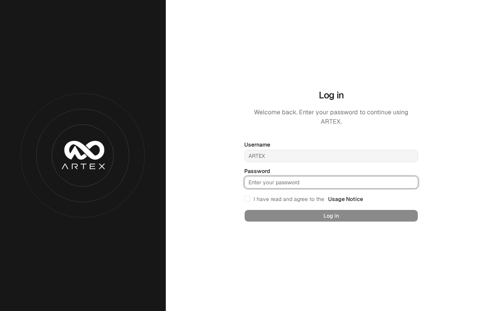

# Local English edition

The UI (including login/setup), backend default messages, and new agent output
start in English. Existing findings and reports retain their original content.
Internal agent prompts and the upstream translations are preserved.



The browser preference is stored under `artex_en_locale`. The previous
`artex_locale` value is ignored, so browsers from the Korean edition also start
in English. Later selections in Settings still work normally.

## Build and run

The root `docker-compose.override.yml` selects the locally built image and sets
`ARTEX_LANG=en`. Configure `.env` using `.env.example` before starting.

Before replacing an existing container, preserve its signing key:

```bash
docker compose cp artex:/app/jwt.key ./jwt.key
chmod 600 jwt.key
docker compose build artex
docker compose up -d --no-deps artex
```

For a fresh installation (with no existing key), start both services:

```bash
openssl rand -out jwt.key 32
chmod 600 jwt.key
docker compose up -d --build
```

The key and `.env` are ignored by Git
and excluded from the Docker build context. PostgreSQL stays in its existing
volume; application files stay in `data/`.

If an older installation has an explicit output language, choose English in
Settings; stored settings override the server default. Reload the browser after
updating. The local build runs Go vet/tests and the static frontend build;
database integration tests require a separate test database.

## Updates

Rebuild using the commands above after source changes. Avoid the application's
upstream binary updater: an upstream binary does not include these local changes.
The original license and attribution remain applicable.
